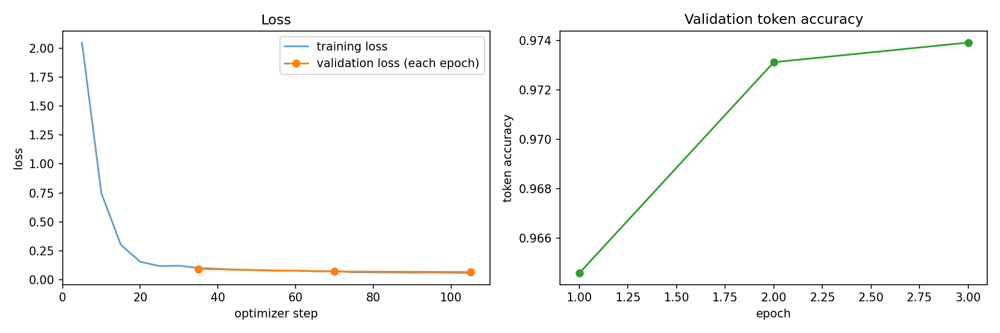
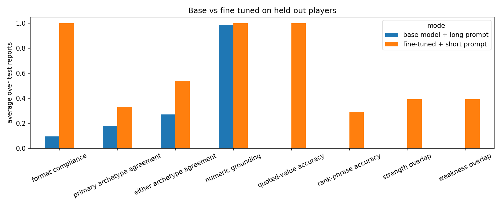
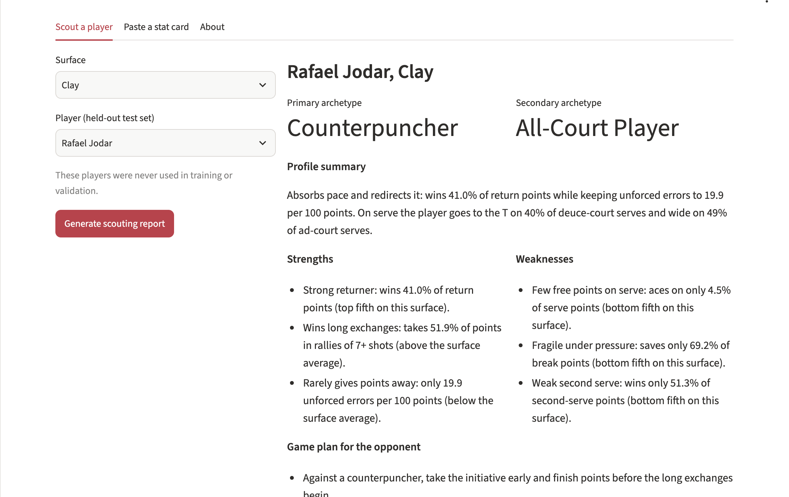

# Tennis Scout AI

A Streamlit app that turns a player's statistical profile into a coach-ready scouting report, using a language model fine-tuned for this task.

This is the Milestone 4 deliverable for DSC 670. Milestone 3 trained the model; this app puts it in front of a user.

## 1. The problem

Coaches prepare for an opponent by reading statistics: serve numbers, rally lengths, net play, and so on. Turning those numbers into a plan takes time. This project asks whether a small language model can read the statistics and write the plan.

## 2. What the app does

The user picks a player and surface, and the app generates a six-section report:

1. Primary archetype
2. Secondary archetype
3. Profile summary
4. Strengths
5. Weaknesses
6. Game plan for the opponent

The five archetypes are aggressive baseliner, counterpuncher, all-court player, serve-plus-one attacker, and defensive specialist.

The app has two ways to supply input:

- **Scout a player:** choose from the 63 held-out test profiles, which the model never saw in training.
- **Paste a stat card:** paste any card in the training format.

Each report shows a numeric-grounding score and can be downloaded as text.

## 3. Data

Source: the Tennis Abstract Match Charting Project (Jeff Sackmann and volunteer charters), licensed CC BY-NC-SA 4.0. Use is non-commercial, with attribution.

- Men's matches since 2010 on hard, clay and grass.
- One **profile** per player per surface, built from at least 5 charted matches.
- Result: 407 profiles covering 237 players (213 hard, 139 clay, 55 grass).

Each profile becomes a **stat card**: fixed-format text with serve, return, rally, net and groundstroke statistics, plus the player's percentile rank among profiles on the same surface. The model reads only this card.

## 4. Training targets

No public collection of coach-written reports exists, so the target reports come from a transparent rule-based writer. It picks the three strongest and three weakest statistics, quotes their exact numbers, and adds a game plan. Archetype labels also come from explicit percentile rules.

This keeps every number checkable. The cost is that the training prose is template-like, and the labels reflect my rules, not expert judgment.

## 5. Model and training

| Setting | Value |
|---|---|
| Base model | Qwen/Qwen2.5-0.5B-Instruct (494M parameters) |
| Method | Full fine-tune, all weights updated (no LoRA) |
| Data split | 279 train / 65 validation / 63 test, split by player |
| Epochs, learning rate | 3, 3e-5 |
| Effective batch size | 8 (batch 1 with 8 gradient-accumulation steps) |
| Hardware | Google Colab T4 GPU, fp16 |
| Training time | about 21 minutes |

The split is by player, so no player appears in more than one set.

Validation loss fell from 0.094 to 0.068 over three epochs, and validation token accuracy rose from 96.5% to 97.4%. Training and validation loss stayed close, so there is no sign of overfitting. Because the target text follows a fixed template, high token accuracy shows the template was learned, not that the scouting is good.



## 6. Evaluation

Both models were tested on the 63 held-out profiles. The base model received a long instruction prompt; the fine-tuned model received a one-sentence prompt.

| Metric | What it measures | Base | Fine-tuned |
|---|---|---|---|
| Format compliance | All six sections present and in order | 0.095 | 1.000 |
| Primary archetype agreement | Model's primary label equals the rule-based label | 0.175 | 0.333 |
| Either archetype agreement | Rule-based primary label appears as the model's primary or secondary | 0.270 | 0.540 |
| Numeric grounding | Share of numbers in the report that appear in the stat card | 0.99 | 1.00 |
| Quoted-value accuracy | Of the recognized bullets, share quoting the right number | none recognized | 1.000 |
| Rank-phrase accuracy | Of the recognized bullets, share whose rank claim (such as "top fifth") is true | none recognized | 0.294 |
| Strength / weakness overlap | How many of the three reference strengths (weaknesses) the model also chose | 0.000 | 0.392 / 0.392 |



### What the results show

- **Fine-tuning taught the format.** Format compliance rose from 9.5% to 100%, and the fine-tuned model never quoted a wrong number.
- **Archetype choice is weak.** The model matches the rule-based primary label only 33% of the time. It mostly predicts "counterpuncher" or "all-court player", and it rarely predicts "serve-plus-one attacker".
- **Rank claims are unreliable.** The model often attaches the wrong phrase, such as "top fifth", to a correct number.
- **The comparison is not fully fair.** The last four metrics use the vocabulary the fine-tuned model was trained on, so the base model scores near zero by design. The fair comparisons are format compliance, archetype agreement and numeric grounding.

## 7. Limitations

- Labels and target reports come from my own rules, so the scores measure how well the model learned my design, not tennis expertise.
- The dataset is small (407 profiles) and skews toward well-known players, because charters chart high-profile matches.
- The 0.5B model can pick the wrong strengths and weaknesses. Check any report against its stat card.

## 8. Run the app



```
pip install -r requirements.txt
```

Set the location of the fine-tuned model, then start the app:

```
# PowerShell
$env:MODEL_PATH = "path/to/ft_model"
streamlit run app.py

# macOS / Linux
MODEL_PATH=path/to/ft_model streamlit run app.py
```

`MODEL_PATH` can be a local folder or a Hugging Face repo ID. A GPU is strongly recommended; on CPU, expect a minute or more per report.

## 9. Files

- `app.py`: the Streamlit app.
- `requirements.txt`: dependencies.
- `notebooks/DSC670_Milestone3_HF_Colab_v2.ipynb`: the Milestone 3 notebook (data, labels, training, evaluation).
- `launch_in_colab.ipynb`: starts the app in Colab with a public link.
- `DSC670_Milestone4_Presentation.pptx`: the presentation.
- `screenshots/`: screenshots of the running app.
- `outputs/test_profiles.csv`: the 63 held-out profiles and their stat cards.
- `outputs/test_generations.csv`, `outputs/base_generations.csv`: generated reports and per-report scores.
- `outputs/training_log.csv`, `outputs/training_curves.png`, `outputs/eval_comparison.png`: training and evaluation records.

## 10. Credits

Data: Tennis Abstract Match Charting Project, https://github.com/JeffSackmann/tennis_MatchChartingProject (CC BY-NC-SA 4.0).
Base model: Qwen2.5-0.5B-Instruct.
